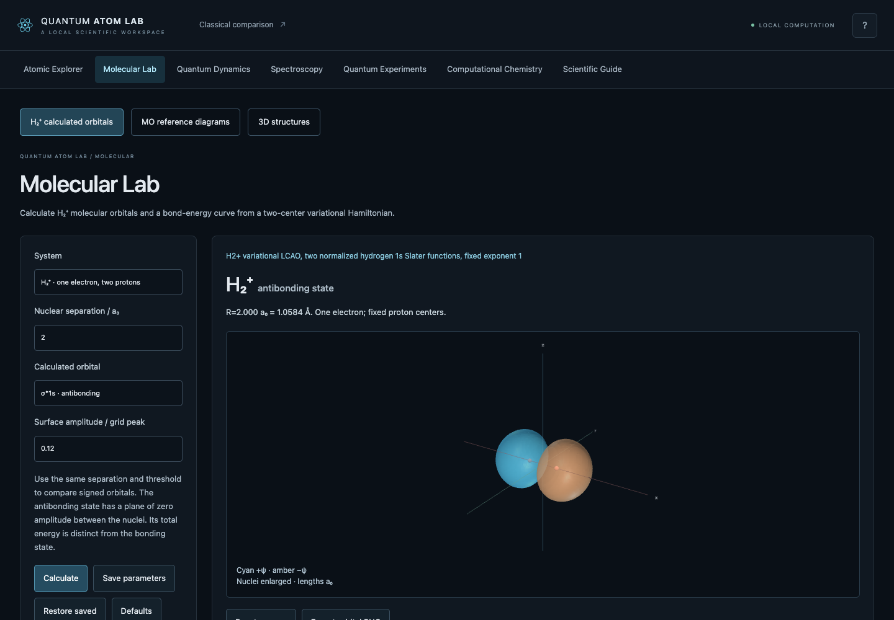

# Quantum Atom Lab 2.0

A local scientific workspace for atomic orbitals, molecular bonding, spectroscopy,
quantum dynamics and small-system computational chemistry. Python calculates the
states and surfaces; TypeScript and Three.js provide the interface. The original
Pygame simulator and Git history are preserved.



## Working laboratories

| Laboratory | Implemented calculation | Scope |
| --- | --- | --- |
| **Atomic Explorer** | Hydrogenic s/p/d/f clouds, surfaces, nodes, real/complex harmonics, radial/angular plots, overlays, isotopes/ions, all 118 elements | Analytic one-electron model; multi-electron Z_eff shapes remain illustrative |
| **Molecular Lab** | H₂⁺ generalized LCAO eigenproblem, bonding/antibonding and original atomic orbitals, overlap/matrices, total-energy curve and minimum | Two normalized fixed-exponent 1s functions; nuclear repulsion included |
| **MO diagrams** | H₂⁺, H₂, He₂, Li₂, B₂, C₂, N₂, O₂, F₂, Ne₂ occupations, spin, frontier levels, bond order and magnetism | Reference-based ordinal diagrams; no calculated many-electron energies or shapes |
| **3D structures** | H₂O, NH₃, CH₄, CO₂, CO, benzene; atoms, connectivity, coordinates, derived bond lengths/angles | Source-preserved PubChem3D conformers; schematic ball sizes, no equilibrium-optimization claim |
| **Quantum Dynamics** | Normalized complex two-state superpositions, exact time phases, playback, density/amplitude and position-expectation plots | 1D infinite square well, not time-dependent hydrogen |
| **Spectroscopy** | Initial/final n,l,m,spin; emission/absorption; E1 polarization/selection rules; calculated dipole strengths; Lyman/Balmer/Paschen series | Reduced-mass hydrogenic, unresolved nonrelativistic vacuum wavelengths |
| **Measurement** | Independent seeded Born-rule samples, theory/histogram comparison, analytical moments, Cartesian position/momentum uncertainties | Repeated preparations; no electron paths or simultaneous exact observables |
| **Tunneling** | Gaussian packet, finite barrier, unitary split-operator FFT, finite-time probability partition, analytical packet reference | 1D bounded grids with boundary and convergence diagnostics |
| **Fields & Spin** | n=2 hydrogen Stark state mixing, weak Zeeman/ Landé splitting, angular momentum addition, Dirac fine structure | Separate first-order experiments; no combined fields, hyperfine or QED |
| **Computational Chemistry** | In-house He/H₂ restricted Hartree–Fock, analytic Gaussian integrals, SCF matrices/history, density/HOMO/LUMO, H₂ energy curve | STO-3G or its uncontracted primitives; no correlation; restricted dissociation is inaccurate |
| **Optional HF / DFT** | Actual PySCF HF, PBE and B3LYP; STO-3G/6-31G; energies, orbitals/density, convergence and same-geometry HF comparison | Closed-shell H₂/He and the six reference molecules; fixed geometry |

Every advanced result includes its model, units and assumptions. Eigenstate
probability density remains stationary; changing global phase does not animate
an electron trajectory. A surface threshold is a fraction of a sampled peak,
not an enclosed probability or electron count.

## Run locally · macOS / Python 3.14

```sh
python3.14 -m venv .venv                 # only if no environment exists
source .venv/bin/activate
python -m pip install -r requirements.txt
npm --prefix frontend ci
npm --prefix frontend run build
python run.py
```

Open [Quantum Atom Lab](http://127.0.0.1:8765/). Node 20.19+ or 22.12+ and a
WebGL2-capable browser are needed for building/3D viewing. Textual results remain
available if WebGL fails. After installation/build, the app runs offline. No API
keys or paid/cloud services are needed. Change port with `python run.py --port 8766`.

Optional computational backend, validated on this Mac with **Python 3.14.7**:

```sh
.venv/bin/python -m pip install -r requirements-computation.txt
```

PySCF 2.14.0 and h5py 3.16.0 run successfully without changing Python, NumPy or
SciPy versions. They are isolated from the core engine; if absent, optional
calculations report an informative unavailable-engine error. No Python downgrade
or automatic backend install is performed by the application.

For development, run Python in one terminal and `npm --prefix frontend run dev`
in another. Vite proxies `/api` to Python on 8765. Rebuild before using Python's
compiled frontend. Backend changes require restarting Python.

Original classical comparison remains:

```sh
.venv/bin/python main.py
```

Pygame is optional (`requirements-legacy.txt`). Keys 1/2/3 select H/He/Li; P
prints Bohr physics; Escape exits. No original Pygame module was changed.

## Use the workspace

- Choose a laboratory from the navigation; specialized tools have local subnav.
- Rotate by dragging; scroll to zoom; right-drag or Shift-drag to pan. Focus a
  3D canvas to pan with arrows or reset with R. Image exports include model/units.
- Parameter changes hide obsolete lab results; **Calculate** updates them.
  Loading, invalid input, overload, convergence and backend errors are explicit.
- Save/restore lab parameters locally, or return to validated defaults. No
  personal data or secrets are stored. The Scientific Guide opens guided
  activities using the live engines, including 2p nodes, bonding, measurements,
  tunneling, interference and Stark mixing.
- Export scientific CSV/JSON and graph/3D PNG where supplied. Graph axes/legends
  distinguish density, amplitude, potential and total versus orbital energy.
- Mobile controls collapse under **Experiment parameters**. Navigation, graphs
  and wide tables scroll inside their containers. Tested widths span 320–1920 px.
- Keyboard tabs, visible focus, native named dialogs, textual scientific results
  and reduced-motion behavior support accessible exploration.

## Validation

```sh
.venv/bin/python -m unittest discover -s tests -v
npm --prefix frontend run build
npm --prefix frontend run test:e2e
.venv/bin/python -m pip check
```

Browser tests use installed Google Chrome through Playwright. The suite includes
actual WebGL controls, laboratory switching, exports, local presets, request
failure/cancellation, responsive widths, GPU buffer reuse, idle rendering and
axe WCAG 2.2 AA rule checks. Optional PySCF science tests skip explicitly if the
backend is absent; install the optional requirements to exercise DFT end to end.
See [validation](docs/SCIENTIFIC_VALIDATION.md) and the [release audit](docs/RELEASE_AUDIT.md)
for final counts, measurements and actual screenshots. Automated accessibility
checks are not a formal accessibility certification.

## Scientific methods and architecture

The original one-electron engine uses SciPy spherical harmonics, normalized
Laguerre radial functions, reduced mass, inverse-CDF probability samples and
marching cubes. New engines are independent Python modules; scientific values
are separate from HTTP adapters and Three.js. Internal lengths/energies are
atomic units with explicit presentation conversions.

The server binds only to loopback. It bounds handler threads (16), simultaneous
scientific jobs (2), state/grid sizes, caches and native-worker timeouts. Client
abort/revision checks prevent obsolete results from overwriting new selections.
An active core computation finishes independently; optional workers terminate
at 12 seconds. The application exposes no user-supplied shell/code execution,
filesystem writes or remote-execution API.

| Documentation | Contents |
| --- | --- |
| [Baseline audit](docs/BASELINE_AUDIT.md) | Starting state, reproduced issues, original tests/performance |
| [Architecture](docs/ARCHITECTURE.md) | Engine/API/UI/rendering boundaries and concurrency |
| [Scientific methods](docs/SCIENTIFIC_METHODS.md) | Equations, algorithms, units, assumptions and references |
| [Atomic model](docs/ATOMIC_MODEL.md) | Preserved hydrogenic orbital conventions and numerical details |
| [Validation](docs/SCIENTIFIC_VALIDATION.md) | Independent formula/reference/convergence tests |
| [UI/UX audit](docs/UI_UX_AUDIT.md) | Reproduced interface fixes and accessibility checks |
| [Performance](docs/PERFORMANCE.md) | Measured latency, CPU, peak memory and browser behavior |
| [Limitations](docs/LIMITATIONS.md) | Supported approximations and remaining work |
| [Data sources](data/SOURCES.md) | NIST/PubChem/basis snapshots and provenance |

## Limits and next work

The supported models are intentionally narrow. Dynamics/tunneling are 1D;
H₂⁺ uses a small variational basis; multi-electron reference diagrams are not
computed orbitals. RHF excludes correlation and has incorrect dissociation;
optional DFT uses a finite integration grid. Atomic Explorer's many-electron
Z_eff is illustrative. No time-dependent 3D atomic superposition, unrestricted
open-shell SCF, geometry optimization, electrostatic-potential surface, correlated
wavefunction, combined field solver, hyperfine or QED model is provided.

Finite meshes can miss small lobes and tight core density. Structures are
PubChem3D conformers, not experimental equilibrium geometries. Unknown ion
configurations and unverified isotopes remain labeled. Tests validate stated
models, not unsupported physical systems. See the detailed limitations before
using results quantitatively.
