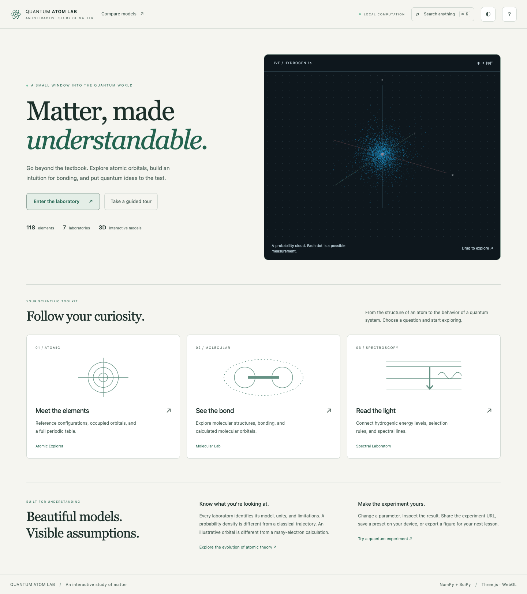
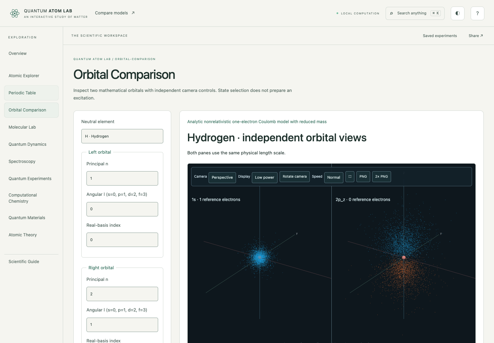

# Quantum Atom Lab

An interactive scientific workspace for atomic orbitals, molecular bonding,
spectroscopy, quantum dynamics and small-system computational chemistry.
Explore all 118 elements, compare orbital shapes and investigate quantum models
with explicit units, data sources and scientific assumptions.

**[Open the live website →](https://quantum-atom-lab-ap95671.pages.dev/)**

No sign-in or installation is needed for the public browser edition. It runs
independently of the developer’s computer. The full Python application provides
additional local research solvers.

## Public website or full local application?

| Version | Address | Advanced Python calculations |
| --- | --- | --- |
| Public browser edition | [Open the deployed website](https://quantum-atom-lab-ap95671.pages.dev/) | Unavailable: this deployment has no Python server. Recorded molecular datasets are labeled. |
| Full local application | [http://127.0.0.1:8765/](http://127.0.0.1:8765/) | Available while the local server is running; HF/DFT and other optional methods also require `requirements-computation.txt`. |

**Already installed?** Start the full application from the repository folder:

```sh
QAL_MODE=local .venv/bin/python run.py --port 8765
```

Leave that terminal running, then open **http://127.0.0.1:8765/**.
`localhost` without `:8765` uses a different port. The hosted website does not
start your local server or provide the advanced Python backend. For a new
installation, follow [Run locally](#run-locally) below, including the optional
computation dependencies if you need research solvers.



## Explore in your browser

| Tool | Open the public workspace |
| --- | --- |
| Atomic Explorer | [Occupied orbitals, allowed states and prepared configurations](https://quantum-atom-lab-ap95671.pages.dev/#lab=atomic) |
| Periodic Table | [118 elements, reference properties and quantitative trends](https://quantum-atom-lab-ap95671.pages.dev/#lab=periodic) |
| Orbital Comparison | [Independent 3D views with a common physical scale](https://quantum-atom-lab-ap95671.pages.dev/#lab=compare) |
| Molecular Lab | [Bonding, molecular structures and recorded HF examples](https://quantum-atom-lab-ap95671.pages.dev/#lab=molecular) |
| Spectroscopy | [Hydrogenic transitions, selection rules and spectral lines](https://quantum-atom-lab-ap95671.pages.dev/#lab=spectroscopy) |
| Quantum Experiments | [Born-rule measurements and supported circuit experiments](https://quantum-atom-lab-ap95671.pages.dev/#lab=experiments) |
| Atomic Theory | [Historical timeline and model comparison](https://quantum-atom-lab-ap95671.pages.dev/#lab=history) |

The browser edition calculates lightweight scientific models on your device and
serves clearly labeled, reproducible H₂, N₂, triplet O₂ and water HF datasets.
Fresh HF/DFT, correlation, geometry optimization and other advanced research
methods require the full local Python application. Unsupported browser tools
explain their scope; recorded results are identified as precomputed.
See the [public model and deployment guide](docs/CLOUDFLARE_PAGES.md).

The production source branch is
[`codex/cloudflare-pages-demo`](https://github.com/Ap-95671/atomic-model/tree/codex/cloudflare-pages-demo).
[Deployment provenance](https://quantum-atom-lab-ap95671.pages.dev/build-info.json)
reports the exact source commit served by the website. A GitHub commit or
successful local build alone is not proof of deployment.

## Workspace features

- **Ground state by default:** element-specific controls show occupied reference
  orbitals, including partially filled subshells and documented configuration
  exceptions. Neutral hydrogen starts in 1s¹.
- **Explicit exploration and preparation:** view other allowed orbital states
  without claiming excitation, or prepare an electron assignment with validated
  electron count, quantum numbers and Pauli exclusion. State preparation is
  distinct from simulating a transition.
- **Periodic reference trends:** filter by element, period or category; explore
  seven source-backed properties; inspect unknown values; export CSV data.
- **Independent orbital comparison:** two camera panes share one WebGL renderer,
  with common-scale or independently fitted clouds and amplitude surfaces.
- **Presentation and export:** camera presets, rotation controls, display quality,
  fullscreen and bounded 1×/2× PNG exports across the 3D laboratories.
- **A consistent workspace:** light/dark themes, responsive controls, Ctrl/Cmd+K
  command search, guided activities, local experiment presets and shareable URLs
  that restore applicable selections, cameras and display settings.



The application is **3.0 alpha**. Its implemented scientific models have stated
limits; it does not claim to complete every research feature in the broader 3.0
roadmap. Many-electron Atomic Explorer shapes remain illustrative hydrogenic
Z_eff models. Exact one-electron solutions, prepared occupancies, molecular
calculations and historical sketches are identified separately. Very heavy
reference configurations retain uncertainty labels. See the
[modernization report](docs/MODERNIZATION.md),
[scientific methods](docs/SCIENTIFIC_METHODS.md) and
[research feature audit](docs/FEATURE_COMPLETENESS_AUDIT.md).

The original Pygame simulator and Git history are preserved. Project licensing
and a stable release remain separate owner decisions.

## Working laboratories

| Laboratory | Implemented calculation | Scope |
| --- | --- | --- |
| **Atomic Explorer** | Hydrogenic s/p/d/f clouds, surfaces, nodes, real/complex harmonics, radial/angular plots, overlays, isotopes/ions, all 118 elements | Analytic one-electron model; multi-electron Z_eff shapes remain illustrative |
| **Periodic Explorer** | Seven PubChem reference properties, filters, point plots and CSV export | Source definitions and missing values are retained; compiled values can include estimates |
| **Orbital Comparison** | Two independently controlled atomic-orbital views, shared scale, phase/density and cloud/surface modes | Individually normalized hydrogenic functions; illustrative Z_eff for many-electron atoms |
| **Atomic Theory** | Sourced timeline and side-by-side historical model explanations | Original conceptual diagrams, not trajectory simulations |
| **Molecular Lab** | H₂⁺ generalized LCAO eigenproblem, bonding/antibonding and original atomic orbitals, overlap/matrices, total-energy curve and minimum | Shared fixed/optimized Slater exponent, measured mesh convergence; nuclear repulsion included |
| **MO diagrams** | H₂⁺, H₂, He₂, Li₂, B₂, C₂, N₂, O₂, F₂, Ne₂ occupations, spin, frontier levels, bond order and magnetism | Reference-based ordinal diagrams; no calculated many-electron energies or shapes |
| **3D structures** | H₂O, NH₃, CH₄, CO₂, CO, benzene; atoms, connectivity, coordinates, derived bond lengths/angles | Source-preserved PubChem3D conformers; schematic ball sizes, no equilibrium-optimization claim |
| **Quantum Dynamics** | Original two-state and 1–8-state well evolution; n≤2 3D hydrogenic superpositions, weighted clouds, phase and position means | Exact finite-eigenbasis evolution; no general spatial TDSE/laser solver |
| **Spectroscopy** | Initial/final n,l,m,spin; emission/absorption; E1 polarization/selection rules; calculated dipole strengths; Lyman/Balmer/Paschen series | Reduced-mass hydrogenic, unresolved nonrelativistic vacuum wavelengths |
| **Measurement** | Independent seeded and accumulating Born-rule batches, actual reset, theory/histograms, analytical moments and uncertainties | Repeated preparations; no electron paths or simultaneous exact observables |
| **Tunneling** | Gaussian packet, finite barrier, unitary split-operator FFT, finite-time probability partition, analytical packet reference | 1D bounded grids with boundary and convergence diagnostics |
| **Fields & Spin** | n=2 hydrogen Stark state mixing, weak Zeeman/ Landé splitting, angular momentum addition, Dirac fine structure | Separate first-order experiments; no combined fields, hyperfine or QED |
| **Computational Chemistry** | In-house He/H₂ restricted Hartree–Fock, analytic Gaussian integrals, SCF matrices/history, density/HOMO/LUMO, H₂ energy curve | STO-3G or its uncontracted primitives; no correlation; restricted dissociation is inaccurate |
| **Calculated molecules** | RHF/UHF/ROHF, spin-aware PBE/B3LYP; STO-3G/6-31G/cc-pVDZ; every α/β MO, density/spin density, SCF diagnostics | Explicit O₂ triplet, selected spin is input; reference diagrams remain separate |
| **Geometry & vibrations** | Analytic-gradient BFGS, initial/final overlay, force history, distances/angles; analytic mass-weighted Hessian, frequencies and mode playback | 2–5 atoms, closed-shell RHF/RKS, ≤50 AOs; harmonic, no IR/Raman intensities |
| **Correlation** | MP2, CCSD, CCSD(T), CISD, FCI, contiguous-frontier CASCI/CASSCF; actual H₂ RHF/UHF/MP2/FCI stretching comparison | Closed-shell, ≤30 AOs, bounded CI space; single-reference/active-space limitations explicit |
| **Electronic excitations** | TDHF/TDDFT/TDA-CIS vertical singlets, oscillator strengths, transition dipoles, NTO pair data, absorption plot | ≤5 states; arbitrary Gaussian broadening, reference HOMO in viewport |
| **Open systems** | Constant-generator Lindblad matrix evolution, density matrices, Bloch sphere, purity, entropy, relaxation/dephasing | Markovian ideal qubit, chosen time units; trace/Hermiticity/positivity checked |
| **Quantum computing** | 1–5 qubit circuits and measurements; actual H₂/STO-3G Jordan–Wigner ideal VQE against same-sector diagonalization | No hardware/noise claim; two-determinant H₂-specific doubles ansatz |
| **Materials** | Chain/square/honeycomb nearest-neighbor tight-binding bands, reciprocal cells, lattice patches, DOS | Illustrative user parameters; no real-material dataset/periodic DFT claim |
| **Adaptive baseline** | Measured HF/MP2/CCSD accuracy/latency lookup with exact-condition matching and explicit abstention | Six generated finite-basis FCI-reference cases; no ML/generalization/uncertainty guarantee |

Every advanced result includes its model, units and assumptions. Eigenstate
probability density remains stationary; changing global phase does not animate
an electron trajectory. A surface threshold is a fraction of a sampled peak,
not an enclosed probability or electron count.

## Run locally

Validated with Python 3.14.7 and Node.js 24. A WebGL2-capable browser is needed
for 3D rendering; textual scientific results remain available without WebGL.
Use the production branch for the complete application described here:

```sh
git clone --branch codex/cloudflare-pages-demo https://github.com/Ap-95671/atomic-model.git
cd atomic-model

python3.14 -m venv .venv                 # only if no environment exists
source .venv/bin/activate
python -m pip install -r requirements.txt
npm --prefix frontend ci
npm --prefix frontend run build
python run.py
```

Open [the local application](http://127.0.0.1:8765/). After installation/build, the app runs offline. No API
keys or paid/cloud services are needed. Change port with `python run.py --port 8766`.

Install the optional computational backend **before starting the server** to enable
PySCF HF/DFT, geometry, vibrations and other supported research calculations.
Validated on this Mac with **Python 3.14.7**:

```sh
.venv/bin/python -m pip install -r requirements-computation.txt
```

PySCF 2.14.0 and h5py 3.16.0 run successfully without changing Python, NumPy or
SciPy versions. They are isolated from the core engine; if absent, optional
calculations report an informative unavailable-engine error. No Python downgrade
or automatic backend install is performed by the application.

For development, run Python in one terminal and `npm --prefix frontend run dev`
in another. Vite proxies `/api` to Python on 8765. Rebuild before using Python's
compiled frontend. Backend changes require restarting Python. If localhost refuses the connection, run
`QAL_MODE=local .venv/bin/python run.py --port 8765` and keep it running. Check
[server health](http://127.0.0.1:8765/api/health) and
[capabilities](http://127.0.0.1:8765/api/capabilities); the latter must report
`"mode": "local"` and `"advanced_computation": true`. A static Pages preview
cannot run those Python methods. After installing optional dependencies, restart
Python and reload the page.

Original classical comparison remains:

```sh
.venv/bin/python main.py
```

Pygame is optional (`requirements-legacy.txt`). Keys 1/2/3 select H/He/Li; P
prints Bohr physics; Escape exits. No original Pygame module was changed.

## Use the workspace

- Choose a laboratory from the navigation; specialized tools have local subnav.
- Use **Prepare an excited configuration** to edit occupancies. Use **Explore
  allowed orbital states** to inspect shapes without changing the reference atom.
- Rotate by dragging; scroll to zoom; right-drag or Shift-drag to pan. Focus a
  3D canvas to pan with arrows or reset with R. Image exports include model/units.
- Parameter changes hide obsolete lab results; **Calculate** updates them.
  Loading, invalid input, overload, convergence and backend errors are explicit.
- Save/restore lab parameters locally, or return to validated defaults. No
  personal data or secrets are stored. The Scientific Guide opens guided
  activities using the live engines, including 2p nodes, bonding, measurements,
  tunneling, interference and Stark mixing.
- Export scientific CSV/JSON and graph/3D PNG where supplied. Graph axes/legends
  distinguish density, amplitude, potential and total versus orbital energy.
- Atomic mobile controls collapse under **Atom & orbital controls**; other
  laboratory settings use **Experiment parameters**. Navigation, graphs
  and wide tables scroll inside their containers. Tested widths span 320–1920 px.
- Keyboard tabs, visible focus, native named dialogs, textual scientific results
  and reduced-motion behavior support accessible exploration.

## Validation

The modernization source checkpoint
[`c7e1d53`](https://github.com/Ap-95671/atomic-model/commit/c7e1d534ae5ef0231cab39d98267adea1c659c1c)
passed all four [GitHub Actions validation jobs](https://github.com/Ap-95671/atomic-model/actions/runs/41670469380):
core science, chemistry/browser, public container and static browser build.

| Validation | Observed result |
| --- | --- |
| Python science/API tests | 139 passed |
| Existing browser-science reference checks | 5,356 passed |
| Preparation and periodic-property checks | 2,457 passed |
| Full local Chrome workflows | 155 passed |
| Final UI/contrast regression checks | 46 passed |
| API-free static browser workflows | 16 passed |
| Linux container public-mode browser workflows | 8 passed |
| TypeScript, local/static builds, dependency consistency | Passed |

Run the relevant checks locally:

```sh
.venv/bin/python -m unittest discover -s tests -v
npm --prefix frontend run test:science
node scripts/test_frontend_lifecycle.mjs
npm --prefix frontend run build
npm --prefix frontend run test:e2e
npm --prefix frontend run build:pages
QAL_STATIC_TEST=1 npm --prefix frontend run test:e2e
.venv/bin/python -m pip check
```

Browser tests require Google Chrome through Playwright. Install it with
`npx playwright install chrome` from `frontend` if it is not already available.
Optional PySCF tests explicitly skip when that engine is absent.

Coverage includes real WebGL interaction, exports, configuration validation,
refresh/history, cancellation, saved settings, responsive layouts, phase/density
labels, bounded memory/context use and axe WCAG rule checks. Original laboratory
navigation is stressed for 50 cycles; comparison/periodic views have additional
memory and context regressions. These checks are not an accessibility certification
or a claim about every browser, screen reader or physical phone.

The [modernization report](docs/MODERNIZATION.md) records the measured performance,
source provenance and model limits. The main JS gzip size changed from 190.74 to
171.18 kB; local repeat-switch median was 34.2 ms before and 34.9 ms after. These
observations do not establish a universal speedup.

## Build the public browser edition

```sh
npm --prefix frontend ci
npm --prefix frontend run test:science
npm --prefix frontend run build:pages
npm --prefix frontend run preview:pages
```

Open [the static preview](http://127.0.0.1:8770/). The output is
`frontend/dist-pages`; it has no Python runtime, server API or paid cloud bindings.
Publishing updates to `codex/cloudflare-pages-demo` triggers the existing
Cloudflare Pages Git integration. Verify the source SHA in
[build-info.json](https://quantum-atom-lab-ap95671.pages.dev/build-info.json) and run
the public HTTPS checks before recording a deployment as complete. Full details
are in the [Cloudflare deployment guide](docs/CLOUDFLARE_PAGES.md).

## Scientific methods and architecture

The original one-electron engine uses SciPy spherical harmonics, normalized
Laguerre radial functions, reduced mass, inverse-CDF probability samples and
marching cubes. New engines are independent Python modules; scientific values
are separate from HTTP adapters and Three.js. Internal lengths/energies are
atomic units with explicit presentation conversions.

The server binds only to loopback. It bounds handler threads (16), simultaneous
scientific jobs (2), state/grid sizes, caches and native-worker timeouts. Client
abort/revision checks prevent obsolete results from overwriting new selections.
Short core computations finish independently. New chemistry jobs expose progress
and actual process cancellation, with a 90-second timeout; the preserved legacy
HF/DFT GET worker retains its 12-second timeout. The application exposes no user-supplied shell/code execution,
filesystem writes or remote-execution API.

| Documentation | Contents |
| --- | --- |
| [Frontend modernization](docs/MODERNIZATION.md) | Current interface, prepared configurations, trends, comparison, tests and measured performance |
| [Public browser deployment](docs/CLOUDFLARE_PAGES.md) | Live-site architecture, model availability, provenance and deployment configuration |
| [Baseline audit](docs/BASELINE_AUDIT.md) | Starting state, reproduced issues, original tests/performance |
| [Architecture](docs/ARCHITECTURE.md) | Engine/API/UI/rendering boundaries and concurrency |
| [Scientific methods](docs/SCIENTIFIC_METHODS.md) | Equations, algorithms, units, assumptions and references |
| [Atomic model](docs/ATOMIC_MODEL.md) | Preserved hydrogenic orbital conventions and numerical details |
| [Validation](docs/SCIENTIFIC_VALIDATION.md) | Independent formula/reference/convergence tests |
| [UI/UX audit](docs/UI_UX_AUDIT.md) | Reproduced interface fixes and accessibility checks |
| [Performance](docs/PERFORMANCE.md) | Measured latency, CPU, peak memory and browser behavior |
| [Limitations](docs/LIMITATIONS.md) | Supported approximations and remaining work |
| [Data sources](data/SOURCES.md) | NIST/PubChem/basis snapshots and provenance |

## Python SDK and reproducibility

```sh
.venv/bin/python -m pip install . --no-build-isolation
.venv/bin/python examples/sdk_basics.py
# Optional, using the existing computation environment:
.venv/bin/python examples/sdk_chemistry.py
.venv/bin/python scripts/benchmark3.py
.venv/bin/python scripts/benchmark_adaptive.py
```

```python
from quantum_atom_lab import HydrogenicOrbital
orbital = HydrogenicOrbital(n=2, l=1, m=0)
print(orbital.probability_density(x=0., y=0., z=1.))
```

The versioned experimental SDK includes its required reference data and runs
without the HTTP/frontend packages. A standalone wheel is built and tested
outside the checkout; no PyPI publication is performed. See the [public API](docs/PYTHON_SDK.md),
[research baseline](docs/ADAPTIVE_ENGINE.md), [contribution guide](CONTRIBUTING.md),
[changelog](CHANGELOG.md) and [license/dependency review](docs/LICENSE_REVIEW.md).
GitHub Actions defines core-only Python 3.14 and optional-chemistry/Chrome jobs;
local validation and observed hosted-CI results are reported separately.

## Limits and next work

Remaining work includes general spatial 3D TDSE/laser propagation, nuclear MD,
validated reaction/transition-state pathways, broader combined external fields,
IR/Raman derivative intensities, dedicated NTO surfaces, geometry import and
open-shell geometry/post-HF workflows; real materials reference datasets and
periodic DFT; a generalizable accuracy-aware research router with independent
large benchmarks and calibrated uncertainty. Current exact-condition benchmark
lookup is a transparent baseline, not a learned or general-purpose predictor.

Device-local experiment presets and applicable camera/overlay restoration are
implemented. Portable account-backed workspaces, exhaustive device coverage and
a full controller refactor remain outside this release. Finite meshes may omit small
lobes and under-resolve tight cores. Many-electron Atomic Explorer Z_eff remains
illustrative; source structures remain PubChem conformers unless separately
optimized. See [limits](docs/LIMITATIONS.md) and the audit for the detailed scope.

A resource-bounded **Railway public-demo image is implemented and container-tested**;
cloud activation is currently blocked because the signed-in Railway account
requires a paid upgrade while the approved budget is free/trial only. **Railway is not deployed; the separate Cloudflare Pages demo is linked above.** See [Railway deployment status and instructions](docs/RAILWAY_DEPLOYMENT.md).
The full advanced local app remains available. License approval, PyPI publication
and a stable 3.0 release remain pending.


## Railway / Docker public mode

```sh
docker build --platform linux/amd64 -t quantum-atom-lab:railway .
docker run --rm --memory=512m --cpus=1 -p 127.0.0.1:8767:8080 -e PORT=8080 quantum-atom-lab:railway
```

This image independently builds Node/Python dependencies and serves frontend and
APIs together. Public mode uses Uvicorn, one isolated scientific worker, bounded
preview grids, time/RSS/rate/response/cache limits, and honest explanations for
advanced-local-only calculations. It contains no PySCF. Runtime binds 0.0.0.0
inside the container and reads Railway's `PORT`; ordinary `python run.py` keeps
full local mode on localhost. No Render project, tunnel or Mac-hosted sharing is
used. The [deployment guide](docs/RAILWAY_DEPLOYMENT.md) lists exact supported
features, environment variables, costs, tests, redeployment and the current
billing blocker. A successful container is not a successful public deployment.
