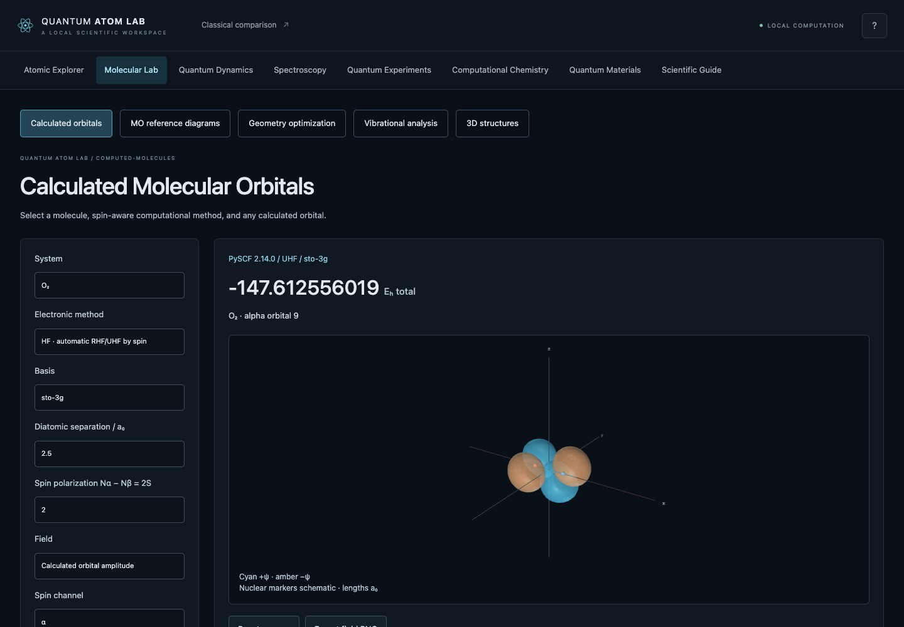

# Quantum Atom Lab 3.0 alpha · validated milestones

A local scientific workspace for atomic orbitals, molecular bonding, spectroscopy,
quantum dynamics and small-system computational chemistry. Python calculates the
states and surfaces; TypeScript and Three.js provide the interface. The original
Pygame simulator and Git history are preserved.



Incremental development on unmerged 2.0 PR #2. This alpha implements tested
chemistry, dynamics and quantum-model milestones; it does **not** complete every
item in the 3.0 specification. The [current audit](docs/FEATURE_COMPLETENESS_AUDIT.md)
and [implementation report](docs/QUANTUM_LAB_3_COMPLETION.md) distinguish working
calculations from remaining work. Project licensing awaits owner approval.

## Working laboratories

| Laboratory | Implemented calculation | Scope |
| --- | --- | --- |
| **Atomic Explorer** | Hydrogenic s/p/d/f clouds, surfaces, nodes, real/complex harmonics, radial/angular plots, overlays, isotopes/ions, all 118 elements | Analytic one-electron model; multi-electron Z_eff shapes remain illustrative |
| **Molecular Lab** | H₂⁺ generalized LCAO eigenproblem, bonding/antibonding and original atomic orbitals, overlap/matrices, total-energy curve and minimum | Shared fixed/optimized Slater exponent, measured mesh convergence; nuclear repulsion included |
| **MO diagrams** | H₂⁺, H₂, He₂, Li₂, B₂, C₂, N₂, O₂, F₂, Ne₂ occupations, spin, frontier levels, bond order and magnetism | Reference-based ordinal diagrams; no calculated many-electron energies or shapes |
| **3D structures** | H₂O, NH₃, CH₄, CO₂, CO, benzene; atoms, connectivity, coordinates, derived bond lengths/angles | Source-preserved PubChem3D conformers; schematic ball sizes, no equilibrium-optimization claim |
| **Quantum Dynamics** | Original two-state and 1–8-state well evolution; n≤2 3D hydrogenic superpositions, weighted clouds, phase and position means | Exact finite-eigenbasis evolution; no general spatial TDSE/laser solver |
| **Spectroscopy** | Initial/final n,l,m,spin; emission/absorption; E1 polarization/selection rules; calculated dipole strengths; Lyman/Balmer/Paschen series | Reduced-mass hydrogenic, unresolved nonrelativistic vacuum wavelengths |
| **Measurement** | Independent seeded and accumulating Born-rule batches, actual reset, theory/histograms, analytical moments and uncertainties | Repeated preparations; no electron paths or simultaneous exact observables |
| **Tunneling** | Gaussian packet, finite barrier, unitary split-operator FFT, finite-time probability partition, analytical packet reference | 1D bounded grids with boundary and convergence diagnostics |
| **Fields & Spin** | n=2 hydrogen Stark state mixing, weak Zeeman/ Landé splitting, angular momentum addition, Dirac fine structure | Separate first-order experiments; no combined fields, hyperfine or QED |
| **Computational Chemistry** | In-house He/H₂ restricted Hartree–Fock, analytic Gaussian integrals, SCF matrices/history, density/HOMO/LUMO, H₂ energy curve | STO-3G or its uncontracted primitives; no correlation; restricted dissociation is inaccurate |
| **Calculated molecules** | RHF/UHF/ROHF, spin-aware PBE/B3LYP; STO-3G/6-31G/cc-pVDZ; every α/β MO, density/spin density, SCF diagnostics | Explicit O₂ triplet, selected spin is input; reference diagrams remain separate |
| **Geometry & vibrations** | Analytic-gradient BFGS, initial/final overlay, force history, distances/angles; analytic mass-weighted Hessian, frequencies and mode playback | 2–5 atoms, closed-shell RHF/RKS, ≤50 AOs; harmonic, no IR/Raman intensities |
| **Correlation** | MP2, CCSD, CCSD(T), CISD, FCI, contiguous-frontier CASCI/CASSCF; actual H₂ RHF/UHF/MP2/FCI stretching comparison | Closed-shell, ≤30 AOs, bounded CI space; single-reference/active-space limitations explicit |
| **Electronic excitations** | TDHF/TDDFT/TDA-CIS vertical singlets, oscillator strengths, transition dipoles, NTO pair data, absorption plot | ≤5 states; arbitrary Gaussian broadening, reference HOMO in viewport |
| **Open systems** | Constant-generator Lindblad matrix evolution, density matrices, Bloch sphere, purity, entropy, relaxation/dephasing | Markovian ideal qubit, chosen time units; trace/Hermiticity/positivity checked |
| **Quantum computing** | 1–5 qubit circuits and measurements; actual H₂/STO-3G Jordan–Wigner ideal VQE against same-sector diagonalization | No hardware/noise claim; two-determinant H₂-specific doubles ansatz |
| **Materials** | Chain/square/honeycomb nearest-neighbor tight-binding bands, reciprocal cells, lattice patches, DOS | Illustrative user parameters; no real-material dataset/periodic DFT claim |
| **Adaptive baseline** | Measured HF/MP2/CCSD accuracy/latency lookup with exact-condition matching and explicit abstention | Six generated finite-basis FCI-reference cases; no ML/generalization/uncertainty guarantee |

Every advanced result includes its model, units and assumptions. Eigenstate
probability density remains stationary; changing global phase does not animate
an electron trajectory. A surface threshold is a fraction of a sampled peak,
not an enclosed probability or electron count.

## Run locally · macOS / Python 3.14

```sh
python3.14 -m venv .venv                 # only if no environment exists
source .venv/bin/activate
python -m pip install -r requirements.txt
npm --prefix frontend ci
npm --prefix frontend run build
python run.py
```

Open [Quantum Atom Lab](http://127.0.0.1:8765/). Node 20.19+ or 22.12+ and a
WebGL2-capable browser are needed for building/3D viewing. Textual results remain
available if WebGL fails. After installation/build, the app runs offline. No API
keys or paid/cloud services are needed. Change port with `python run.py --port 8766`.

Optional computational backend, validated on this Mac with **Python 3.14.7**:

```sh
.venv/bin/python -m pip install -r requirements-computation.txt
```

PySCF 2.14.0 and h5py 3.16.0 run successfully without changing Python, NumPy or
SciPy versions. They are isolated from the core engine; if absent, optional
calculations report an informative unavailable-engine error. No Python downgrade
or automatic backend install is performed by the application.

For development, run Python in one terminal and `npm --prefix frontend run dev`
in another. Vite proxies `/api` to Python on 8765. Rebuild before using Python's
compiled frontend. Backend changes require restarting Python.

Original classical comparison remains:

```sh
.venv/bin/python main.py
```

Pygame is optional (`requirements-legacy.txt`). Keys 1/2/3 select H/He/Li; P
prints Bohr physics; Escape exits. No original Pygame module was changed.

## Use the workspace

- Choose a laboratory from the navigation; specialized tools have local subnav.
- Rotate by dragging; scroll to zoom; right-drag or Shift-drag to pan. Focus a
  3D canvas to pan with arrows or reset with R. Image exports include model/units.
- Parameter changes hide obsolete lab results; **Calculate** updates them.
  Loading, invalid input, overload, convergence and backend errors are explicit.
- Save/restore lab parameters locally, or return to validated defaults. No
  personal data or secrets are stored. The Scientific Guide opens guided
  activities using the live engines, including 2p nodes, bonding, measurements,
  tunneling, interference and Stark mixing.
- Export scientific CSV/JSON and graph/3D PNG where supplied. Graph axes/legends
  distinguish density, amplitude, potential and total versus orbital energy.
- Mobile controls collapse under **Experiment parameters**. Navigation, graphs
  and wide tables scroll inside their containers. Tested widths span 320–1920 px.
- Keyboard tabs, visible focus, native named dialogs, textual scientific results
  and reduced-motion behavior support accessible exploration.

## Validation

```sh
.venv/bin/python -m unittest discover -s tests -v
npm --prefix frontend run build
npm --prefix frontend run test:e2e
.venv/bin/python -m pip check
```

Browser tests use installed Google Chrome through Playwright. The suite includes
actual WebGL controls, laboratory switching, exports, local presets, request
failure/cancellation, responsive widths, GPU buffer reuse, idle rendering and
axe WCAG 2.2 AA rule checks. Optional PySCF science tests skip explicitly if the
backend is absent; install the optional requirements to exercise DFT end to end.
See [validation](docs/SCIENTIFIC_VALIDATION.md) and the [release audit](docs/RELEASE_AUDIT.md)
for final counts, measurements and actual screenshots. Automated accessibility
checks are not a formal accessibility certification.

## Scientific methods and architecture

The original one-electron engine uses SciPy spherical harmonics, normalized
Laguerre radial functions, reduced mass, inverse-CDF probability samples and
marching cubes. New engines are independent Python modules; scientific values
are separate from HTTP adapters and Three.js. Internal lengths/energies are
atomic units with explicit presentation conversions.

The server binds only to loopback. It bounds handler threads (16), simultaneous
scientific jobs (2), state/grid sizes, caches and native-worker timeouts. Client
abort/revision checks prevent obsolete results from overwriting new selections.
Short core computations finish independently. New chemistry jobs expose progress
and actual process cancellation, with a 90-second timeout; the preserved legacy
HF/DFT GET worker retains its 12-second timeout. The application exposes no user-supplied shell/code execution,
filesystem writes or remote-execution API.

| Documentation | Contents |
| --- | --- |
| [Baseline audit](docs/BASELINE_AUDIT.md) | Starting state, reproduced issues, original tests/performance |
| [Architecture](docs/ARCHITECTURE.md) | Engine/API/UI/rendering boundaries and concurrency |
| [Scientific methods](docs/SCIENTIFIC_METHODS.md) | Equations, algorithms, units, assumptions and references |
| [Atomic model](docs/ATOMIC_MODEL.md) | Preserved hydrogenic orbital conventions and numerical details |
| [Validation](docs/SCIENTIFIC_VALIDATION.md) | Independent formula/reference/convergence tests |
| [UI/UX audit](docs/UI_UX_AUDIT.md) | Reproduced interface fixes and accessibility checks |
| [Performance](docs/PERFORMANCE.md) | Measured latency, CPU, peak memory and browser behavior |
| [Limitations](docs/LIMITATIONS.md) | Supported approximations and remaining work |
| [Data sources](data/SOURCES.md) | NIST/PubChem/basis snapshots and provenance |

## Python SDK and reproducibility

```sh
.venv/bin/python -m pip install . --no-build-isolation
.venv/bin/python examples/sdk_basics.py
# Optional, using the existing computation environment:
.venv/bin/python examples/sdk_chemistry.py
.venv/bin/python scripts/benchmark3.py
.venv/bin/python scripts/benchmark_adaptive.py
```

```python
from quantum_atom_lab import HydrogenicOrbital
orbital = HydrogenicOrbital(n=2, l=1, m=0)
print(orbital.probability_density(x=0., y=0., z=1.))
```

The versioned experimental SDK includes its required reference data and runs
without the HTTP/frontend packages. A standalone wheel is built and tested
outside the checkout; no PyPI publication is performed. See the [public API](docs/PYTHON_SDK.md),
[research baseline](docs/ADAPTIVE_ENGINE.md), [contribution guide](CONTRIBUTING.md),
[changelog](CHANGELOG.md) and [license/dependency review](docs/LICENSE_REVIEW.md).
GitHub Actions defines core-only Python 3.14 and optional-chemistry/Chrome jobs;
local validation and observed hosted-CI results are reported separately.

## Limits and next work

Remaining work includes general spatial 3D TDSE/laser propagation, nuclear MD,
validated reaction/transition-state pathways, broader combined external fields,
IR/Raman derivative intensities, dedicated NTO surfaces, geometry import and
open-shell geometry/post-HF workflows; real materials reference datasets and
periodic DFT; a generalizable accuracy-aware research router with independent
large benchmarks and calibrated uncertainty. Current exact-condition benchmark
lookup is a transparent baseline, not a learned or general-purpose predictor.

Named portable workspaces, every camera/overlay/GPU/device combination and a
full controller refactor are also incomplete. Finite meshes may omit small
lobes and under-resolve tight cores. Many-electron Atomic Explorer Z_eff remains
illustrative; source structures remain PubChem conformers unless separately
optimized. See [limits](docs/LIMITATIONS.md) and the audit for the detailed scope.

A resource-bounded **Railway public-demo image is implemented and container-tested**;
cloud activation is currently blocked because the signed-in Railway account
requires a paid upgrade while the approved budget is free/trial only. **No public
HTTPS website is deployed.** See [Railway deployment status and instructions](docs/RAILWAY_DEPLOYMENT.md).
The full advanced local app remains available. License approval, PyPI publication
and a stable 3.0 release remain pending.


## Railway / Docker public mode

```sh
docker build --platform linux/amd64 -t quantum-atom-lab:railway .
docker run --rm --memory=512m --cpus=1 -p 127.0.0.1:8767:8080 -e PORT=8080 quantum-atom-lab:railway
```

This image independently builds Node/Python dependencies and serves frontend and
APIs together. Public mode uses Uvicorn, one isolated scientific worker, bounded
preview grids, time/RSS/rate/response/cache limits, and honest explanations for
advanced-local-only calculations. It contains no PySCF. Runtime binds 0.0.0.0
inside the container and reads Railway's `PORT`; ordinary `python run.py` keeps
full local mode on localhost. No Render project, tunnel or Mac-hosted sharing is
used. The [deployment guide](docs/RAILWAY_DEPLOYMENT.md) lists exact supported
features, environment variables, costs, tests, redeployment and the current
billing blocker. A successful container is not a successful public deployment.
