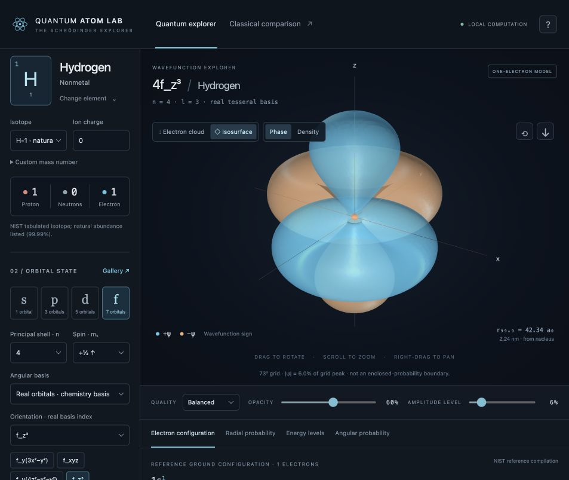

# Quantum Atom Lab

A local, interactive 3D Schrödinger orbital laboratory built on the original
`atomic-model` Python project. Python computes the wavefunctions, samples, and
surfaces; Three.js renders them with a movable 3D camera.



The original seven Pygame modules are **unchanged**. The new primary entry point
is `run.py`; `main.py` remains the working classical comparison.

## Quick start · macOS / Python 3.14.7

The existing `.venv` has been preserved and used for validation. From this folder:

```sh
source .venv/bin/activate
python -m pip install -r requirements.txt
cd frontend
npm ci
npm run build
cd ..
python run.py
```

Open **http://127.0.0.1:8765/**. Node 20.19+ or 22.12+ is required for the build
(Node 24.13 was used here). A WebGL2-capable browser with hardware acceleration
is required. After the build, only the Python server is needed; the app works
offline. Dependencies need an internet connection for initial installation.
No API keys, paid services, cloud accounts, or Python downgrade are required.

If `.venv` does not exist, first create it with your Python 3.14 interpreter:

```sh
python3.14 -m venv .venv
```

To change the server port: `python run.py --port 8766`. It always binds to
127.0.0.1. It exposes no shell-launch or filesystem-write endpoints.

### Development · two terminals

```sh
# Terminal 1, repository root
source .venv/bin/activate
python run.py
```

```sh
# Terminal 2, repository root
cd frontend
npm run dev
```

Open Vite's printed local URL (normally http://127.0.0.1:5173). `/api` requests
are proxied to Python on port 8765. Edit Python and restart its process; Vite
reloads frontend edits automatically. Use `npm run build` before serving the
compiled frontend from Python again.

### Original live classical model

```sh
.venv/bin/python main.py
```

Keys **1 / 2 / 3** select hydrogen, helium, lithium; **P** prints hydrogen Bohr
physics; **Escape** exits. The browser's Classical Comparison button explains
both models and gives these launch instructions. It deliberately does not
execute local processes through HTTP. Pygame remains optional for the quantum
app; install `requirements-legacy.txt` only in a new environment that needs it.
No use of `pygame.font` or `pygame.freetype` has been added.

## Explore

- Start with hydrogen **1s**, then choose **n = 2** for **2s**, with its radial
  node. Select p / d / f to reach the minimum valid shell automatically.
- Rotate by dragging, zoom by scrolling, pan with right-drag or Shift-drag.
  Focus the viewport and press **R**, or click the reset-camera button.
- Switch **Electron cloud / Isosurface** and **Phase / Density** independently.
  Cyan and amber represent positive/negative real amplitude; probability is
  always nonnegative. Complex states use a cyclic phase hue.
- Select **all five d** or **all seven f** real functions using the orientation
  selector or Gallery. Both 4f and 5f are supported, along with valid s/p/d/f
  states through n = 8. These mathematical demonstrations are independent of
  ground-state occupancy, so hydrogen can display an excited 4f state.
- Toggle nodal surfaces, axes, nucleus, and camera auto-rotation. Set opacity,
  point count, surface threshold, and quality. The image button saves the raw
  viewport PNG; include the scientific labels when sharing it.
- Search the **118-element periodic table** by name, symbol, number, or category.
  Select an isotope or custom mass number and set an integer charge. Counts
  update as p = Z, n = A − Z, e = Z − charge. Unverified compositions are labeled.
- Click a nucleus particle or particle-count button for charge, mass, and role.
- Inspect reference configurations, shell populations, Hund/Pauli spin diagrams,
  radial and angular probability plots, and hydrogenic energy levels.
- Choose one orbital, all states in a subshell, or up to eight occupied states.
  Checkboxes control layer visibility. Every layer uses the same spatial scale.
  Overlays combine separate orbital densities, not a many-electron wavefunction.
- For one-electron species, select initial/final n in Energy Levels to calculate
  emission/absorption photon energy, frequency, and wavelength. Electric-dipole
  selection rules are explained; choosing n alone does not establish a line.

On narrow windows the viewport comes first and controls stack below it. On
wide windows the side panels scroll independently. Dialogs support Escape,
Tab navigation, and focus return. A scientific guide is available in the app.

## Scientific basis

Internal lengths are in Bohr radii a₀. The effective length is
`a = a₀ / (Z μ/mₑ)`, with μ the electron–nucleus reduced mass. The normalized
radial solution is

```text
ρ = 2r / (n a)
Rₙₗ(r) = (2/(n a))^(3/2) √[(n−l−1)! / (2n (n+l)!)]
          × exp(−ρ/2) ρˡ L^(2l+1)_(n−l−1)(ρ)
ψₙₗₘ(r,θ,φ) = Rₙₗ(r) Yₗᵐ(θ,φ)
```

For an infinitely heavy hydrogen nucleus,
`ψ₁₀₀ = exp(−r/a₀) / √(π a₀³)`. Ordinary hydrogen's reduced-mass correction
slightly changes this length and gives a nonrelativistic 1s energy near
−13.5983 eV. CODATA constants come from SciPy.

Spherical harmonics use SciPy's `sph_harm_y(l, m, theta, phi)` convention:
θ is polar angle, φ azimuth, including the Condon–Shortley phase. Real
harmonics use `√2 (−1)^|m| Re(Y_l^|m|)` for positive basis index and the
corresponding imaginary part for negative index. The m = 0 harmonic is real.
The common real pₓ, pᵧ, d, and f functions are **superpositions of ±mₗ**;
they are generally not L_z eigenstates. The interface labels m as a real-basis
index, or as definite mₗ when the complex basis is selected.

Real hydrogenic orbitals have `n−l−1` radial nodes, `l` angular nodes, and
`n−1` total nodes. Complex states need a more careful geometric interpretation:
there are `l−|m|` polar nodal cones and polar-axis zeros, rather than the
azimuthal nodal planes of a real combination. The interface explains this.

Clouds use inverse-CDF radial samples of `r² |R|² dr` and rejection-sampled
angular density with uniform cosθ and φ proposals. The spherical volume
factor is included. Samples represent outcomes from repeated measurements in
an identically prepared state, not known simultaneous electron positions.

Surfaces use scikit-image marching cubes on a vectorized wavefunction grid.
The grid is concentrated near the origin; vertices are mapped back to physical
coordinates after extraction. Positive and negative real amplitude surfaces
are extracted separately. Complex surfaces use |ψ| and color arg(ψ).
**Thresholds are fractions of the grid's peak amplitude**, not enclosed
probabilities. Angular nodes are extracted from the corresponding solid harmonic;
radial node radii come from associated Laguerre roots. The graph extends to
99.9% radial probability; cloud sampling retains the far tail.

### Exact, approximate, schematic

| Component | Interpretation |
| --- | --- |
| Hydrogenic ψ, nodes, Coulomb energy | Analytic within the nonrelativistic point-nucleus one-electron model; finite numerical evaluation and discretization |
| Reduced mass | Measured proton for H-1; otherwise nuclear mass estimated from atomic isotope mass minus electron masses, neglecting binding mass |
| Multi-electron shapes | Hydrogenic demonstrations with an explicit illustrative Z_eff; no self-consistent screening or electron correlation |
| Neutral configurations / selected ions | Bundled reference assignments; not predictions from a many-electron solver; unsupported charge states show unknown |
| Superheavy neutral assignments | Explicitly predicted/unverified; not experimentally established claims |
| Orbital box diagrams | Hund/Pauli occupancy conventions; not a resolved atomic term or measured orbital orientation |
| Multiple-orbital overlays | Separately normalized orbital distributions; no exact many-electron wavefunction claim |
| Nucleus | Enlarged schematic individual nucleons; positions are not a nuclear many-body calculation |
| Legacy Bohr view | Educational circular-orbit comparison only |

Relativity, spin–orbit/fine/hyperfine structure, Lamb shifts, finite nuclear
size, external fields, and time-dependent superpositions are omitted. High-Z
one-electron ions especially require relativistic corrections for accuracy.
Spin changes the displayed quantum state label/occupancy, not the spatial
hydrogenic density in this spin-independent Hamiltonian.

## Data and references

[Data provenance and rebuild notes](data/SOURCES.md) document all retained
source snapshots, uncertainty handling, isotope-default selection, and the
lawrencium correction. The JSON includes all 118 elements and 354 NIST-tabulated isotope
entries; an explicitly schematic fallback is available if future source data omit an element. Natural abundance does not
imply nuclear stability; half-lives are not bundled.

- [NIST DLMF §14.30: spherical harmonics](https://dlmf.nist.gov/14.30)
- [SciPy `sph_harm_y` conventions](https://docs.scipy.org/doc/scipy/reference/generated/scipy.special.sph_harm_y.html)
- [Harvard course notes: spherical harmonics and hydrogen](https://people.math.harvard.edu/~ctm/home/text/class/harvard/114/14/html/hydrogen.html)
- [NIST electron configurations, H–U and first cations](https://math.nist.gov/DFTdata/atomdata/configuration.html)
- [NIST isotope masses and compositions](https://physics.nist.gov/PhysRefData/Compositions/)
- [NIH PubChem periodic table](https://pubchem.ncbi.nlm.nih.gov/periodic-table/)
- [NIST current lawrencium entry](https://physics.nist.gov/cgi-bin/Elements/elInfo.pl?element=103)

Neutral Cr and Cu exceptions, transition-metal first-ion rearrangements, and
Nd's 4f occupancy are included. A small curated multiply charged cation table
includes Fe²⁺/Fe³⁺, Cu²⁺, Cr²⁺/Cr³⁺, and Nd³⁺. Unknown ions keep their correct
particle counts but do not receive a fabricated ground configuration.

## Architecture

```text
main.py, atom.py, electron.py, nucleus.py, elements.py, constants.py, physics.py
                            # original Pygame modules, unchanged
run.py                      # primary launcher
legacy/README.md            # comparison instructions
quantum_engine/              # constants, validation, wavefunctions, sampling,
                            # energy levels, atomic species, configurations
backend/                    # bounded cached geometry, read-only local HTTP API
frontend/src/               # TypeScript interface and Three.js visualization
data/                       # generated offline JSON, source snapshots, provenance
tests/                      # unittest science and HTTP contract tests
scripts/                    # deterministic data rebuild and memory benchmark
```

The backend uses Python's standard HTTP server instead of an extra web framework:
this is a loopback-only local laboratory with a small read-only API. The frontend
is TypeScript/Vite with Three.js and no UI framework. This keeps the scientific
engine in Python, avoids font issues, and adds only three direct Python numerical
dependencies. It is not intended as a public multi-user production server.

### Performance and storage

- Preview / Balanced / High grids: **49³ / 73³ / 105³**, with nonuniform physical
  spacing. Default clouds: **5k / 18k / 45k** points; adjustable from 1k to 60k.
- A 16-entry LRU stores compact NumPy geometry arrays. Isotope and charge changes
  reuse dimensionless geometry with an analytic length rescaling. Radial CDFs
  are separately cached. At most two geometry calculations run simultaneously.
- Secondary overlay layers use preview quality and at most 9k points each.
  Clouds draw half their points during camera interaction. Surface computation
  stays on the Python side and never runs on the browser UI thread.
- Measured on this Mac/Python 3.14.7: backend imports about 72 MiB; one balanced
  1s cloud about 77 MiB peak; one high 4f surface plus nodes about 235 MiB;
  seven high f geometries cached about 270 MiB peak in a serial benchmark.
  These are process high-water marks, not total system usage. HTTP serialization,
  simultaneous jobs, browser JavaScript, GPU buffers and browser overhead add
  memory. Run `python scripts/benchmark.py` to measure your environment.
- Installed project occupied about **326 MB**: 233 MB existing/extended `.venv`,
  91 MB frontend development dependencies, and around 1 MB source/data/build.
  Screenshots add a small amount. Allow **400 MB** for the working project.

### Local API

| GET path | Purpose |
| --- | --- |
| `/api/health` | Health and element count |
| `/api/elements` | Periodic-table data |
| `/api/species?z=26&a=56&charge=2` | Composition and reference occupancy |
| `/api/orbital?n=4&l=3&m=-2&mode=surface` | Wavefunction-derived geometry and graphs |
| `/api/energy?z=1&initial=3&final=2` | One-electron levels and transition |

Orbital options also include `z`, `a`, `charge`, `basis=real|complex`,
`spin=±0.5`, `quality=preview|balanced|high`, `points`, `threshold`,
`nodes=true|false`, and illustrative `zeff` for multi-electron demonstrations.
Invalid states or particle counts return JSON errors. Geometry overload returns
503 rather than scheduling unbounded concurrent work.

## Validation

```sh
.venv/bin/python -m unittest discover -s tests -v
cd frontend
npm run build
```

The 36-test suite covers quantum-number rejection; closed-form 1s behavior;
radial normalization through n = 8; real/complex angular orthonormality;
radial roots; analytic p/d/f angular geometry and phase; nonnegative density;
Monte Carlo radial/angular moments; reduced-mass energy and Balmer wavelength;
all 118 electron counts; Hund/Pauli constraints; Cr/Cu and first-ion exceptions;
isotopes; ions; valid extracted meshes and field residuals; caching; and HTTP
validation including refusal to assign hydrogenic energy to many-electron atoms.
Tests use Python's built-in unittest; no extra test dependency is required.

A dummy-SDL smoke check also launched and exited the unchanged Pygame model.
Browser checks cover the live WebGL app, 2p lobes/nodal plane, orbital selection,
element composition, plots, and interaction controls. Finite-grid surfaces
are educational visualizations, not quantum-chemistry accuracy benchmarks.

## Known limitations and next work

- No Hartree–Fock, DFT, correlated many-electron solver, or nuclear dynamics.
- Ion-reference coverage is deliberately limited; arbitrary anions and many
  higher charge states are unknown, even when particle counts are valid.
- Superheavy configurations and unlisted isotope existence/stability remain
  explicitly uncertain. Bundled reference data are snapshots, not live updates.
- High-n inner lobes can be under-resolved. Surface thresholds can hide weak
  lobes. Use clouds, lower thresholds, and the radial plot to inspect them.
- Angular nodal meshes currently support the real basis; complex radial nodes
  remain available. Nodal meshes are clipped to the numerical domain.
- Overlay colors identify layers; the primary selected state retains the phase
  legend. They are not a correlated many-electron wavefunction or a full
  spin-summed total density calculation.
- Transitions calculate level differences and show the level ladder; they do
  not animate paths or assert that a line is electric-dipole allowed from n alone.
- The raw exported viewport PNG omits HTML labels. Add the model/scale labels
  when sharing. The legacy model launches in its own Pygame window.
- NumPy 2.5 currently triggers scikit-image 0.26 internal deprecation warnings
  during marching cubes. These upstream warnings do not fail calculations/tests.
